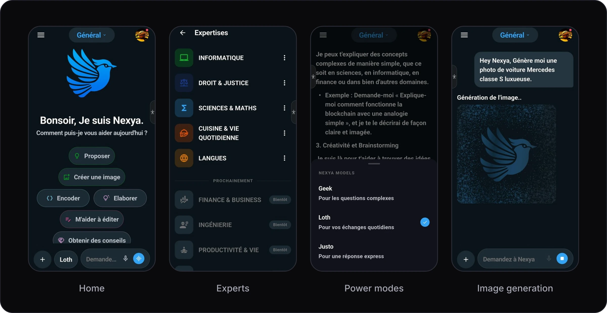
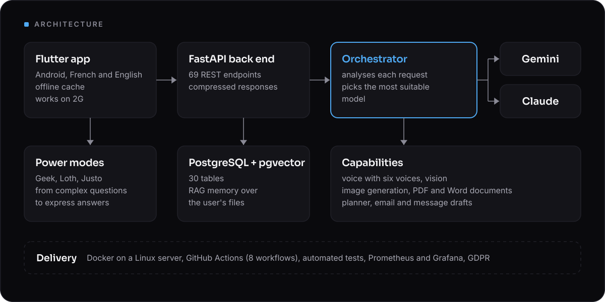

<picture>
  <source media="(prefers-color-scheme: dark)" srcset="https://raw.githubusercontent.com/lothngassa/nexya-ai/main/assets/banner-dark.svg">
  <source media="(prefers-color-scheme: light)" srcset="https://raw.githubusercontent.com/lothngassa/nexya-ai/main/assets/banner-light.svg">
  
</picture>

 

NEXYA AI is a multi-expert generative AI assistant for Android, in French and English. It has been on Google Play since May 2026. I designed and built it on my own, from the database to the app in the store.

This repository is a showcase. The production code stays private.

<a href="https://play.google.com/store/apps/details?id=com.nexyalabs.nexya"><b>Google Play</b> ↗</a>&emsp;
<a href="https://nexyalabs.com">nexyalabs.com ↗</a>&emsp;
<a href="https://lothngassa.com/en/projets/nexya/">Case study ↗</a>

## What it does

- **Six experts online**: General, Computer science, Science and maths, Law and justice, Languages, Cooking and daily life. Five more are in preparation: Studio, Finance and business, Engineering, Productivity, Medicine.
- **An orchestrator** analyses each request and picks the most suitable model, Gemini or Claude.
- **Three power modes**: Geek for complex questions, Loth for everyday exchanges, Justo for express answers.
- **RAG memory** with PostgreSQL and pgvector, so it can answer from your own files.
- **Voice, vision and documents**: dictation and read-aloud with six voices, photos and documents, image generation, PDF and Word files, a planner, email and message drafts.
- **Built for weak networks**: offline cache, compressed responses, usable on 2G.

## Screens

<picture>
  <source media="(prefers-color-scheme: dark)" srcset="https://raw.githubusercontent.com/lothngassa/nexya-ai/main/assets/screens-dark.webp">
  <source media="(prefers-color-scheme: light)" srcset="https://raw.githubusercontent.com/lothngassa/nexya-ai/main/assets/screens-light.webp">
  
</picture>

## Architecture

<picture>
  <source media="(prefers-color-scheme: dark)" srcset="https://raw.githubusercontent.com/lothngassa/nexya-ai/main/assets/architecture-dark.svg">
  <source media="(prefers-color-scheme: light)" srcset="https://raw.githubusercontent.com/lothngassa/nexya-ai/main/assets/architecture-light.svg">
  
</picture>

## In numbers

| | |
|---:|---|
| **69** | REST endpoints |
| **30** | PostgreSQL tables |
| **8** | GitHub Actions workflows |
| **29 of 30** | blind tests where the answer with RAG was judged better |

## How it ships

Docker on a Linux server, continuous integration with GitHub Actions, automated tests, monitoring with Prometheus and Grafana, and GDPR compliance.

## What comes next

- The iOS version.
- The five experts in preparation.
- For the Languages expert, a prototype: fine-tuning an open Gemma model on Medumba, Duala, Bassa and Ewondo. No results to report yet.

 

Built by [Loth Ngassa](https://lothngassa.com/en/), founder of Nexyalabs.
